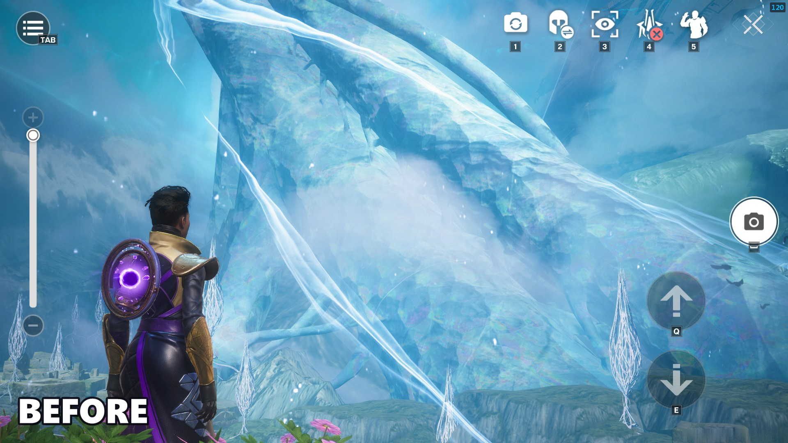
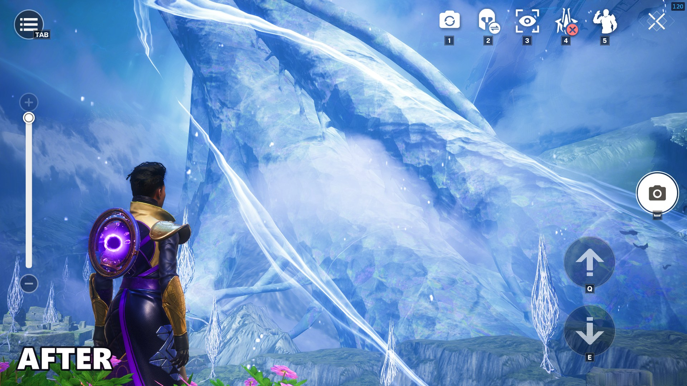
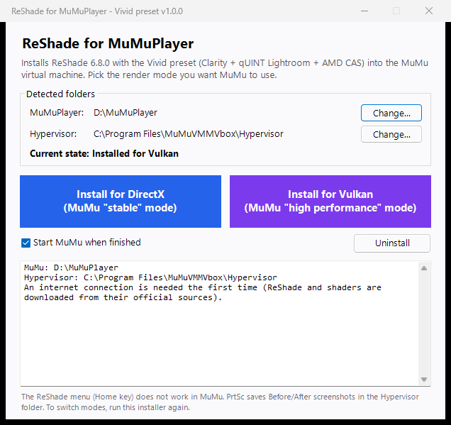

# Destiny Rising – ReShade for MuMuPlayer

[](https://github.com/KIexster/DestinyRising-ReShade-MuMu/releases/latest)


A one-click installer that brings **ReShade 6.8.0** and a hand-tuned **"Vivid" preset** to **Destiny Rising** running on **MuMuPlayer**, in both **DirectX** and **Vulkan** render modes.

ReShade does not work on MuMuPlayer out of the box. The emulator renders the game in a hidden virtual-machine process, and in Vulkan mode it blocks every Vulkan layer. This installer handles all of that for you.

| Before | After (Vivid preset) |
|:---:|:---:|
|  |  |

## Features

- **DirectX and Vulkan support.** Pick MuMu's "stable" (DirectX) or "high performance" (Vulkan) mode. The installer also switches MuMu's render mode for you.
- **Vivid preset.** Deeper blue skies, cleaner haze, richer greens and pinks, more contrast and crisper detail, without a yellow cast.
- **Before/After screenshots.** Every <kbd>PrtSc</kbd> saves the same frame with and without effects.
- **Nothing third-party bundled.** ReShade and the shaders are downloaded from their official sources, pinned to exact versions and verified with SHA-256.
- **Clean switching and uninstall.** Run the installer again to switch modes or remove everything. Your screenshots are kept.
- **No administrator rights needed** on a standard MuMu install. The installer asks for elevation only if your Hypervisor folder is protected.

## Requirements

- Windows 10 or 11
- MuMuPlayer 5.x, the version with the `MuMuVMMVbox` hypervisor. Tested on MuMuPlayer Global 5.30.2.
- An internet connection the first time you install (about 4 MB)

## Installation

1. Download `DestinyRising-ReShade-MuMu-v1.0.0.zip` from the [latest release](https://github.com/KIexster/DestinyRising-ReShade-MuMu/releases/latest) and extract it.
2. Double-click **`Install ReShade MuMu.bat`**.
3. Check that both folders were detected. Use **Change...** if one is missing:
   - **MuMuPlayer**: the folder that contains `nx_main`, e.g. `D:\MuMuPlayer`
   - **Hypervisor**: the folder that contains `MuMuVMMHeadless.exe`, usually `C:\Program Files\MuMuVMMVbox\Hypervisor`
4. Click **Install for DirectX** or **Install for Vulkan**.



The installer closes MuMu if it is running (this can take up to 2 minutes), installs everything, sets MuMu's render mode and starts MuMu again.

> [!IMPORTANT]
> Don't change the render mode in MuMu's own settings. Run the installer again and pick the other button instead. Otherwise ReShade won't load in the new mode.

## The Vivid preset

| Effect | What it does |
|---|---|
| **Clarity** (AstrayFX) | Gentle local contrast that brings back definition in distant mountains and clouds |
| **qUINT Lightroom** | Per-hue grading: shifts the cyan haze toward blue and whitens it, boosts greens, blues, pinks and reds, and adds contrast and a touch of exposure, with no global warmth |
| **AMD FidelityFX CAS** | Contrast-adaptive sharpening (0.6) |

The preset file is `Vivid.ini` in the Hypervisor folder. See [`installer/data/Vivid.ini`](installer/data/Vivid.ini) for all values.

## Known limitations

- **The ReShade menu (<kbd>Home</kbd>) can't be opened.** MuMu draws the game in a disabled child window that belongs to the VM process. Keyboard and mouse input never reach ReShade, so the effects work but the overlay does not.
  - To tweak the preset, edit `Vivid.ini` and restart MuMu. ReShade only reads the preset at startup.
- **<kbd>PrtSc</kbd> is the only key ReShade sees.** ReShade polls that one key directly; all others arrive as window messages, which ReShade never receives in MuMu. You can take about one screenshot every 5 seconds.
- **No depth-based effects.** ReShade can't access the game's depth buffer inside the emulator, so effects like ambient occlusion, depth of field or fog won't work.
- **MuMu updates can remove ReShade.** If the effects disappear after an update, run the installer again.

## How it works

<details>
<summary>Technical details</summary>

**Which process renders the game.** In MuMuPlayer 5.x the MuMu window (`MuMuNxDevice.exe`) only hosts the UI. The Android screen is rendered by the VM process `MuMuVMMHeadless.exe` in the Hypervisor folder, through `libRenderer.dll`. That process draws into a disabled `nemuwin` child window embedded in MuMu's window. ReShade has to be injected into the VM process.

**DirectX mode.** `libRenderer` uses ANGLE on Direct3D 11 and presents through a DXGI swap chain. ReShade is installed as `dxgi.dll` next to `MuMuVMMHeadless.exe`.

**Vulkan mode.** On startup, `libRenderer.dll` (`gi::DisableVulkanImplicitLayers`) sets these variables:

```
VK_LOADER_LAYERS_DISABLE=~implicit~
VK_LOADER_LAYERS_ALLOW=*renderdoc*
```

That disables every implicit Vulkan layer except those whose name contains `renderdoc`. Only if setting those variables fails does it fall back to disabling layers one by one from the registry.

The installer registers ReShade's layer under the name `VK_LAYER_reshade_renderdoc`, for the current user only (`HKCU\SOFTWARE\Khronos\Vulkan\ImplicitLayers`). This works because the VM process is not elevated. The layer DLL lives in `%LOCALAPPDATA%\ReShade\MuMu`. When ReShade is loaded as a layer, it reads `ReShade.ini` from the executable's folder.

**Only one mode at a time.** ReShade refuses to initialize if another ReShade instance is already loaded in the process. That's why the installer removes the DirectX `dxgi.dll` when installing for Vulkan, and unregisters the Vulkan layer when installing for DirectX.

**Pinned downloads.** `ReShade64.dll` is extracted from the official `ReShade_Setup_6.8.0.exe`, which embeds a zip archive.

| File | Source | Version |
|---|---|---|
| `ReShade64.dll` | [reshade.me](https://reshade.me) – `ReShade_Setup_6.8.0.exe` | 6.8.0 |
| `ReShade.fxh` | [crosire/reshade-shaders](https://github.com/crosire/reshade-shaders) | `fd00221` |
| `CAS.fx` | [CeeJayDK/SweetFX](https://github.com/CeeJayDK/SweetFX) | `93ddf39` |
| `qUINT_lightroom.fx`, `qUINT_common.fxh` | [martymcmodding/qUINT](https://github.com/martymcmodding/qUINT) | `98fed77` |
| `Clarity.fx` | [BlueSkyDefender/AstrayFX](https://github.com/BlueSkyDefender/AstrayFX) | `59bae8b` |

Every file is checked against a SHA-256 hash in [`Installer.ps1`](installer/Installer.ps1) and cached in `%LOCALAPPDATA%\ReShade\MuMu\downloads`.

</details>

### What gets installed where

| Location | Contents |
|---|---|
| Hypervisor folder | `reshade-shaders\`, `ReShade.ini`, `Vivid.ini`, and `dxgi.dll` (DirectX mode only) |
| `%LOCALAPPDATA%\ReShade\MuMu` | Download cache, plus `ReShade64.dll` and the layer manifest (Vulkan mode only) |
| `HKCU\SOFTWARE\Khronos\Vulkan\ImplicitLayers` | Layer registration (Vulkan mode only) |

## Troubleshooting

- **"Windows protected your PC" or the script won't start.** Right-click the downloaded zip, open **Properties**, tick **Unblock**, and extract it again.
- **No effects in game.**
  - Run the installer and check **Current state**.
  - Make sure MuMu's render mode matches what you installed.
  - `ReShade.log` in the Hypervisor folder shows whether ReShade loaded.
- **Effects stopped working after a MuMu update.** Run the installer again. If Vulkan no longer works, MuMu may have changed its layer filter; use DirectX.

## Disclaimer

Destiny Rising is an online game with anti-cheat. ReShade only changes how the image looks, but this installer loads it into MuMu's virtual-machine process. **Use it at your own risk.**

This project is not affiliated with or endorsed by NetEase, Bungie, MuMuPlayer or the ReShade project.

## Credits

- [ReShade](https://reshade.me) by crosire
- [SweetFX](https://github.com/CeeJayDK/SweetFX) by CeeJay.dk, including AMD FidelityFX CAS by Advanced Micro Devices
- [qUINT](https://github.com/martymcmodding/qUINT) by Pascal Gilcher (Marty McFly)
- Clarity by Ioxa, maintained in [AstrayFX](https://github.com/BlueSkyDefender/AstrayFX) by BlueSkyDefender

## License

The installer and the Vivid preset are released under the [MIT License](LICENSE). Third-party components are not included in this repository. They are downloaded from their authors at install time and remain under their own licenses; see [THIRD_PARTY_NOTICES.md](THIRD_PARTY_NOTICES.md).
